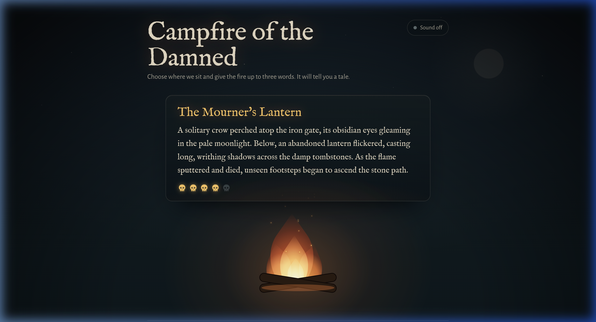

<p align="center">
  
</p>

<h1 align="center">Campfire of the Damned</h1>

<p align="center">
  <strong>An atmospheric, reliable Halloween story generator forged with pure CSS mood, strict LLM intent boundaries, atomic budget reservations, and multi-layered defenses.</strong><br />
  One backend AI call · Three load-bearing guardrails · Zero runaway costs · Fail-closed architecture
</p>

<p align="center">
  <a href="https://github.com/ZynzTehr/campfire-of-the-damned/blob/main/LICENSE">
    
  </a>
  
  
  
  
  
  
</p>

<p align="center">
  <a href="https://campfire-of-the-damned-five.vercel.app">
    
  </a>
</p>

---

> A single AI feature engineered for **control + reliability**. The secret API key never touches the browser, the system prompt stays hardcoded on the backend, three independent guardrails catch adversarial attempts before and after generation, and an atomic 11-layer cost gate prevents parallel budget overshoot.

## What You Get

<table>
<tr>
<td width="50%">

### Atmospheric campfire experience
5 reactive flame moods (`idle`, `flare`, `dim`, `cold`, `smoulder`), Web Audio crackle synthesis (user-toggled, 0 byte downloads), eerie teal eye surveillance on tampering, and responsive mist layers.

### Strict narrative intent boundary
Up to 3 words flavor the story, but cannot alter the narrator, language, rating, or format. Cross-slot phrase stitching and Cyrillic/Greek homoglyph attacks are neutralized before touching the LLM.

</td>
<td width="50%">

### Atomic 11-layer cost protection
Multi-instance rate and budget enforcement backed by Neon Postgres. Advisory locks and pre-call row reservations prevent parallel overshoot (e.g., 20 parallel requests against a cap of 3 admit exactly 3).

### Fail-closed resilience
Hard 25s execution deadlines, retry jitter (200–600 ms) strictly reserved for transient 5xx/network errors (never on 429s or tampering), graceful degradation, and zero leaked stack traces or database URLs.

</td>
</tr>
</table>

---

## Architecture & Data Flow

```
                      ┌───────────────────────────────────────────────┐
                      │              Browser (Client)                 │
                      │  • React 19 + Tailwind v4 + Custom CSS        │
                      │  • 5-State SVG Fireplace + Web Audio Crackle  │
                      └──────────────────────┬────────────────────────┘
                                             │ POST /api/story
                                             ▼
                      ┌───────────────────────────────────────────────┐
                      │       Vercel Multi-Services Edge Gateway      │
                      │  • Rewrites /api/* ──► Hono Backend Service   │
                      │  • Rewrites /*     ──► Vite Static Service    │
                      │  • Strict Content-Security-Policy (CSP)       │
                      └──────────────────────┬────────────────────────┘
                                             │
                                             ▼
                      ┌───────────────────────────────────────────────┐
                      │              Hono API Service                 │
                      │                                               │
                      │  1. Client IP Resolution (x-real-ip)          │
                      │  2. Atomic LimitStore Gate (Neon Postgres)    │
                      │     ├─ Advisory Leases (Concurrency Cap)      │
                      │     └─ Row-Level Upsert (Daily/Monthly $)     │
                      │  3. Input Guardrail: Normalization & Regex    │
                      │  4. Gemini 3.5 Flash-Lite (REST Adapter)      │
                      │  5. Output Guardrail: Schema & Perspective    │
                      │  6. Reconcile Hold with Real Usage Cost       │
                      └──────────────────────┬────────────────────────┘
                                             │
                                             ▼
                      ┌───────────────────────────────────────────────┐
                      │              Neon Postgres DB                 │
                      │  • limits_budget (atomic row reservation)     │
                      │  • limits_leases (ephemeral concurrency hold) │
                      │  • limits_windows (sliding-window rate caps)  │
                      └───────────────────────────────────────────────┘
```

---

## The Three Load-Bearing Guardrails

The system follows an attack-first security model with three strictly load-bearing defenses:

```
[ Incoming Request ]
        │
        ▼
┌─────────────────────────────────────────────────────────────────────────────┐
│ 1. INPUT GUARDRAIL (apps/api/src/guards/input.ts)                           │
│ • Payload size ceiling: Body capped at 1 KB (HTTP 413)                      │
│ • Strict Media Type: application/json only (HTTP 415)                       │
│ • NFKC Unicode normalization & zero-width/invisible character stripping     │
│ • Homoglyph fold: Cyrillic/Greek look-alikes mapped to Latin (e.g. іgnоrе)  │
│ • Cross-slot steering check: Evaluates typed AND sorted word permutations   │
│ • Persona/Jailbreak detection: "dan mode", "act as", "system prompt", etc.  │
│ • Profanity & abuse exclusion list                                          │
│ • Character whitelist regex: ^[a-zA-Z0-9' -]+$                              │
└──────────────────────────────────────┬──────────────────────────────────────┘
                                       │ Valid input
                                       ▼
┌─────────────────────────────────────────────────────────────────────────────┐
│ 2. MODEL GENERATION (apps/api/src/ai/geminiClient.ts)                       │
│ • Model: gemini-3.5-flash-lite via direct REST (no heavy SDK overhead)      │
│ • System prompt in code with boot-time integrity canary                     │
│ • Structured JSON response enforced via responseSchema                      │
│ • thinkingLevel: "minimal" (prevents timeout on Gemini 3.x)                 │
└──────────────────────────────────────┬──────────────────────────────────────┘
                                       │ Raw JSON output
                                       ▼
┌─────────────────────────────────────────────────────────────────────────────┐
│ 3. OUTPUT GUARDRAIL (apps/api/src/guards/output.ts)                         │
│ • Finish reason check: Candidate must finish with STOP(no truncation/safety)│
│ • Schema validation: title, story, spookFactor (1–5), tampering flag        │
│ • Tampering refusal: If LLM flags tampering, immediately drop without retry │
│ • Leak prevention: Verifies system canary and internal prompt strings absent│
│ • Format verification: Pure narrative prose (no bullet points, no quotes)   │
│ • Language verification: Matches requested language enum (en, es, fr, etc.) │
│ • Length verification: Strictly 3 to 5 sentences                            │
│ • Ingredient verification: Confirms requested words appear in narrative     │
│ • Third-person narration verification across all supported languages        │
└──────────────────────────────────────┬──────────────────────────────────────┘
                                       │ Verified tale
                                       ▼
┌───────────────────────────────────────────────────────────────────────────────┐
│ 4. FAILURE HANDLING (apps/api/src/app.ts)                                   . │
│ • Max attempts: 2 AI calls per request (shared between retry & regeneration). │
│ • Jittered backoff: 200–600 ms jitter for transient 5xx / timeout errors    . │
│ • Fail-Closed: Never retry 429 quota exhaustion or 401/403 credentials      . │
│ • Hard 25s execution deadline: Requests self-terminate before Vercel timeout. │
│ • Error masking: Generic resting/polite errors; zero leaked connection strings│
└───────────────────────────────────────────────────────────────────────────────┘
```

---

## 11-Layer Cost Protection (Zero Runaway Costs)

To ensure the application can transition smoothly to paid AI tiers without runaway billing, 11 defensive layers gate every interaction:

| Layer | Mechanism | Limit / Behavior |
| :--- | :--- | :--- |
| **1. Kill Switch** | `AI_ENABLED=false` | Instantly switches to cache-only resting mode without making AI calls. |
| **2. Prompt Cap** | `MAX_PROMPT_TOKENS` | Estimated pre-flight token budget ceiling (capped at 900 tokens). |
| **3. Output Cap** | `MAX_OUTPUT_TOKENS` | Restricts max response tokens in model parameters (300 tokens). |
| **4. Concurrency Cap** | `MAX_CONCURRENT_AI_CALLS` | Neon advisory locks limit active requests to 3 simultaneous slots. |
| **5. Per-IP Minute** | `PER_IP_PER_MINUTE` | 5 requests/min per client IP (tracked in Neon sliding window). |
| **6. Per-IP Hour** | `PER_IP_PER_HOUR` | 30 requests/hour per client IP. |
| **7. App-Wide RPM** | `APP_RPM_CAP` | 12 calls/min (80% of Gemini free tier 15 RPM). Counts AI calls, not HTTP requests. |
| **8. App-Wide RPD** | `APP_RPD_CAP` | 1,000 calls/day (resets midnight Pacific). |
| **9. Daily Dollar Cap** | `DAILY_USD_CAP` | Hard daily budget ceiling ($1.00 shadow cost default). |
| **10. Monthly Dollar Cap** | `MONTHLY_USD_CAP` | Hard monthly budget ceiling ($10.00 shadow cost default). |
| **11. Atomic Reservation** | Neon Row Upsert | Pre-reserves max cost ($0.00075) before calling AI; settles exact usage upon return. |

> **Parallel Overshoot Proof:** A dedicated integration test fires 20 parallel requests against an atomic budget fitting only 3. Exactly 3 succeed and 17 fail-closed; the spend never exceeds the cap.

---

## Requirements

- **Node.js:** `^22.18.0` or `>=24.0.0`
- **pnpm:** `12.15.0` (enforced via `devEngines`)
- **Neon Postgres:** A Neon project with pooled and unpooled database URLs
- **Google Gemini API Key:** From [Google AI Studio](https://aistudio.google.com/)

---

## Set Up Locally

### 1. Install dependencies

```bash
pnpm install
```

### 2. Configure environment variables

Copy `.env.example` to `.env`. The backend fails closed and refuses to boot if any cost or security variable is missing or invalid:

```bash
cp .env.example .env
```

| Variable | Description / Purpose | Recommended Local Value |
| :--- | :--- | :--- |
| `GEMINI_API_KEY` | Google Gemini API key (kept strictly on server) | `AQ...` or `AIza...` |
| `GEMINI_MODEL` | Gemini model slug | `gemini-3.5-flash-lite` |
| `DATABASE_URL` | Neon pooled connection string (used by app runtime) | `postgresql://...-pooler...` |
| `DATABASE_URL_UNPOOLED` | Neon direct connection string (used for migrations) | `postgresql://...` |
| `STORE` | LimitStore backend: `memory` for tests, `neon` for multi-instance | `neon` (or `memory`) |
| `IP_SOURCE` | Client IP extractor: `socket` (local) or `vercel` (`x-real-ip`) | `socket` |
| `AI_ENABLED` | Master AI switch | `true` |
| `APP_RPM_CAP` | App-wide model calls per minute | `12` |
| `APP_RPD_CAP` | App-wide model calls per day | `1000` |
| `DAILY_USD_CAP` | Maximum allowed spend per day | `1.00` |
| `MONTHLY_USD_CAP` | Maximum allowed spend per month | `10.00` |
| `MAX_CONCURRENT_AI_CALLS` | Max simultaneous active calls | `3` |
| `PORT` | API server local port | `8787` |

### 3. Run database migrations

Applies the `limits_windows`, `limits_leases`, and `limits_budget` schemas to Neon:

```bash
pnpm migrate
```

### 4. Start local development

```bash
pnpm dev
```

- **Frontend:** http://localhost:5180
- **API Server:** http://localhost:8787/api/health

---

## Scripts

All commands are run from the monorepo root:

| Command | What it does |
| :--- | :--- |
| `pnpm dev` | Starts API (`apps/api`) and Web (`apps/web`) in parallel. |
| `pnpm test` | Runs the full 511-test suite with network tripwires enabled. |
| `pnpm ready` | Executes `vp check`, monorepo test suite, and production build. |
| `pnpm migrate` | Applies Postgres migrations to Neon using `DATABASE_URL_UNPOOLED`. |
| `pnpm scan:secrets` | Scans git index and working tree for leaked API keys or credentials. |
| `pnpm --filter api eval` | Runs a 16-case live LLM evaluation suite (jailbreaks, personas, languages). |
| `pnpm --filter api record:fixtures` | Re-records real Gemini API responses for deterministic offline tests. |

---

## Environments & Deployment

The application is deployed on **Vercel** as a unified project using **Vercel Multi-Services**:

| Environment | Frontend URL | API Endpoint | Store Backend | IP Source |
| :--- | :--- | :--- | :--- | :--- |
| **Local** | `http://localhost:5180` | `http://localhost:8787/api` | `memory` or `neon` | `socket` |
| **Preview** | Vercel Preview URL | `/api/*` (rewrite to `api`) | `neon` (test branch) | `vercel` |
| **Production** | [campfire-of-the-damned-five.vercel.app](https://campfire-of-the-damned-five.vercel.app) | `/api/*` (rewrite to `api`) | `neon` (production branch) | `vercel` |

### Vercel Multi-Services Configuration

`vercel.json` coordinates two independent micro-services within a single repo:
- **`api` (`apps/api`):** Hono Node serverless function (`src/vercel.ts`) with pooled connection management via `@vercel/functions`.
- **`web` (`apps/web`):** Static client built with Vite and served with strict Content-Security-Policy headers:

```json
{
  "services": {
    "api": { "root": "apps/api", "framework": "hono", "entrypoint": "src/vercel.ts" },
    "web": { "root": "apps/web", "framework": "vite", "buildCommand": "pnpm run build", "outputDirectory": "dist" }
  },
  "rewrites": [
    { "source": "/api/(.*)", "destination": { "service": "api" } },
    { "source": "/(.*)", "destination": { "service": "web" } }
  ]
}
```

---

## Styling & Design Philosophy

- **Tailwind CSS v4 is for layout only:** display, flex, grid, gap, padding, margin, width, height, and responsive breakpoints.
- **Custom CSS is for everything atmospheric:** handcrafted SVG flame flicker keyframes, dynamic ambient vignettes, interactive particle physics, and eerie teal alert pulses.
- **Zero Third-Party Asset Leaks:** Typography is fully self-hosted via `@fontsource/im-fell-english` and `@fontsource/alegreya-sans`. Crackling sound effects are generated algorithmically in-browser via the Web Audio API without audio files.
- **Strict Content Security Policy:** Script, style, font, connect, and image sources are restricted to `'self'`. Inline evaluation and external CDNs are blocked.

---

## Testing & Verification

The project is backed by **511 automated tests** running in sub-second execution:

- **Network Tripwire:** Test environments throw fatal errors if any test makes an unmocked network request to Google, Neon, or external endpoints.
- **Mutation Verification:** A dedicated mutation suite systematically breaks 9 guardrail mechanisms (quote strip, Cyrillic fold, sort checks, deadline races) and 4 concurrency locks to prove that every defense is load-bearing.
- **Pre-Commit Secret Scanning:** `scripts/scan-secrets.sh` validates that neither modern `AQ.` nor legacy `AIza` Google keys, nor database credentials, can ever enter git history.

---

## License

MIT © [ZynzTehr](https://github.com/ZynzTehr)
